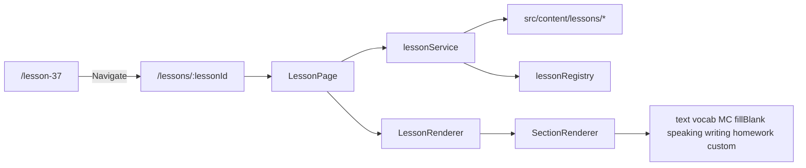

# Content-driven lessons foundation

## Findings (коротко)

- [App.tsx](src/app/App.tsx): окремий Route на кожен `/lesson-XX` і `/hw-XX`.
- Каталог: [lessons.ts](src/data/lessons.ts) + [Lessons.tsx](src/pages/Lessons.tsx); HW: [homeworkList.ts](src/data/homeworkList.ts) + [Homework.tsx](src/pages/Homework.tsx) / [HomeworkLesson.tsx](src/pages/HomeworkLesson.tsx) (старіші HW через task list).
- Повторюване майже всюди: `lesson22-page` hero, back-links, flow anchors, section head, prompt cards, CheckBar, `HomeworkSubmit`.
- Різниця: L36/L38 — багато інтерактивного state + data files; L37 — майже чистий контент (~392 рядки), ідеальний POC.

**POC-урок: Lesson 37** (Present continuous · now vs every day). Чому: типовий speaking-урок, малий обсяг, контент уже структурований масивами, HW окремо на `/hw-37`, не найскладніший (L38/L40 важчі).

## Architecture

## Files to create

| Path                                                                       | Role                                                                                                                                                                      |
| -------------------------------------------------------------------------- | ------------------------------------------------------------------------------------------------------------------------------------------------------------------------- |
| `src/types/lesson.ts`                                                      | Course, Module, Lesson, Section, VocabularyItem, Activity, Homework, PublicationStatus                                                                                    |
| `src/content/lessonRegistry.ts`                                            | Central registry entries (L37 published; місце для інших пізніше)                                                                                                         |
| `src/content/lessons/lesson-37/{lesson,vocabulary,activities,homework}.ts` | Structured content for POC                                                                                                                                                |
| `src/features/lessons/types.ts`                                            | Re-exports / feature-local helpers                                                                                                                                        |
| `src/features/lessons/lessonService.ts`                                    | `getLessonById`, `getPublishedLessons`, `getLessonsByModule` — local content now, Firestore-ready API                                                                     |
| `src/features/lessons/lessonSectionRegistry.ts`                            | Map section type → component                                                                                                                                              |
| `src/features/lessons/sections/*`                                          | Small renderers: TextSection, VocabularySection, MultipleChoiceSection, FillBlankSection, SpeakingPromptSection, WritingPromptSection, HomeworkLinkSection, CustomSection |
| `src/features/lessons/LessonRenderer.tsx`                                  | Maps `lesson.sections`                                                                                                                                                    |
| `src/features/lessons/SectionRenderer.tsx`                                 | Lookup + fallback                                                                                                                                                         |
| `src/features/lessons/LessonPage.tsx`                                      | Route page: loading / not-found / error / published gate                                                                                                                  |
| `src/features/lessons/customs/Lesson37Pictures.tsx`                        | `custom` for zoom figures (Lesson31Figure)                                                                                                                                |

## Files to change (minimal)

- [App.tsx](src/app/App.tsx): add `/lessons/:lessonId` → `LessonPage`; keep all existing routes.
- [Lesson37.tsx](src/pages/Lesson37.tsx): replace body with `<Navigate to="/lessons/37" replace />` (file stays; no delete).
- [lessons.ts](src/data/lessons.ts): L37 `lessonPath` → `/lessons/37` so catalog opens new model.
- [appNav.ts](src/utils/appNav.ts): crumbs for `/lessons/:id` (lesson workspace still matches `/lesson-\d+` and new path).
- Styles: reuse existing `lesson22/25/31.css` from LessonPage; no redesign.

**Do not touch:** Firebase auth, Firestore rules, `studentVocab` / `homeworkAnswers` / `writingSubmissions`, other LessonXX/HWXX pages, env vars.

## Content model (minimum)

- `PublicationStatus`: `draft | review | published | archived`
- `Lesson`: id, number, title, level, moduleId, order, status, estimatedMinutes, hasHomework, legacyRoute?, sections[], homework?
- Sections: `text` | `vocabulary` | `multipleChoice` | `fillBlank` | `speakingPrompt` | `writingPrompt` | `homeworkLink` | `custom`
- Student visibility: `lessonService.getLessonById` returns only `published` (teachers later can extend; no teacher CMS now)

## Lesson 37 section mapping

1. Contrast → `text` (+ paired models)
2. Six verbs → `vocabulary`

3–6. Markers / same verb / ask / look → `speakingPrompt` (+ optional `text` models)
4. Pictures → `custom: lesson37-pictures`
5. Exit → `text` checklist + `homeworkLink` → `/hw-37`

HW37 stays as-is; lesson metadata points to it. No HW rewrite.

## Branch & verification

1. `git checkout -b refactor/content-driven-lessons-foundation` from current `main`
2. `npm run lint`, `npx tsc -b`, `npm run build`
3. Manual: `/lesson-37` redirects; `/lessons/37` renders; `/lessons` card opens new path; `/hw-37` unchanged; other `/lesson-XX` untouched

## Out of scope this PR

- Migrating more lessons
- Firestore content source
- Teacher CMS / draft workflow UI
- Merging to main / deleting legacy pages

